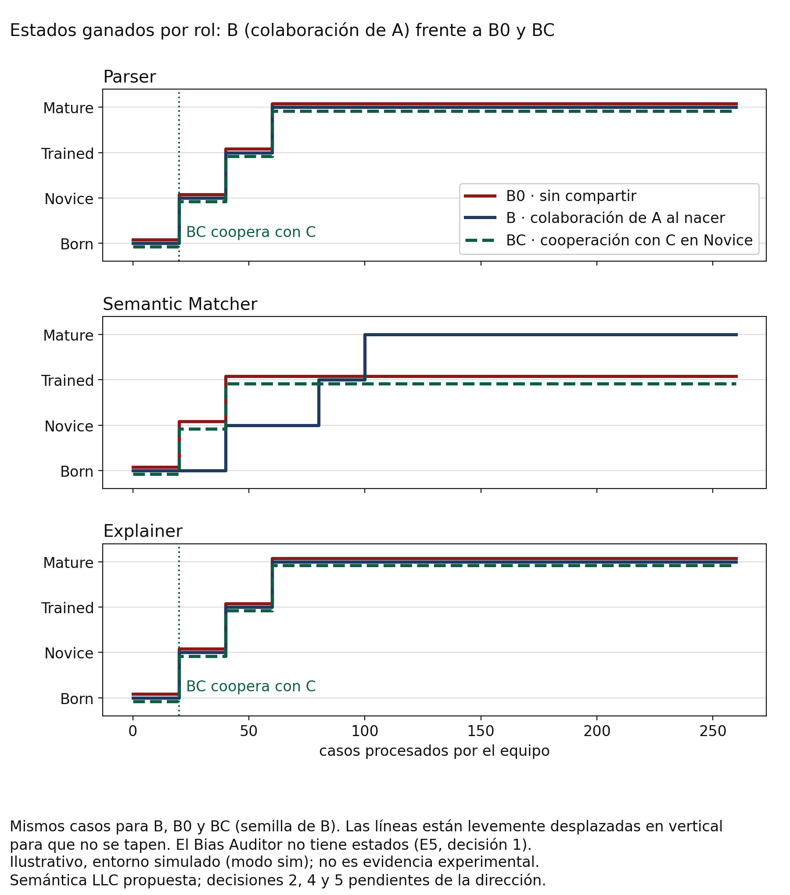

# P3 · Equipos DAG: un equipo maduro hace madurar a otro (E5)

> *Ilustrativo, entorno simulado (modo sim); no es evidencia experimental.* · *Semántica LLC propuesta; decisiones 2, 4 y 5 pendientes de la dirección.*

> Generado por código: ningún número de este documento está escrito a mano.

Reglas pre-registradas en `docs/parada_tecnica/E5_PREREGISTRO.md`.

## Colaboración A → B (al nacer B)

| Rol | Estados (A → B) | Aceptada | Motivo | Iguales / similares / nuevas | Base de B (antes → después) | ΣP = K en B | LCB de Ω (A) |
|---|---|---|---|---|---|---|---|
| Parser | mature → born | sí | axiomas, can_donate y Ω sin evidencia de sesgo | 0 / 0 / 16 | 0 → 16 | sí | 0,000 |
| Semantic Matcher | trained → born | sí | axiomas, can_donate y Ω sin evidencia de sesgo | 0 / 0 / 69 | 0 → 69 | sí | 0,000 |
| Explainer | mature → born | sí | axiomas, can_donate y Ω sin evidencia de sesgo | 0 / 0 / 9 | 0 → 9 | sí | 0,000 |

## Cooperación BC ↔ C (en Novice, ventana a ventana)

| Rol | Ventanas con BC en Novice (estado de C) | Intentos | Resultado |
|---|---|---|---|
| Parser | BIO-W01 (Novice) | 1 | aceptada en BIO-W01 (iguales / similares / nuevas: 8 / 2 / 0; ΣP = K en los dos: sí) |
| Semantic Matcher | BIO-W01 (Born) | 0 | no coincidieron en Novice |
| Explainer | BIO-W01 (Novice) | 1 | aceptada en BIO-W01 (iguales / similares / nuevas: 4 / 0 / 0; ΣP = K en los dos: sí) |

## Ciclos hasta cada cambio de estado

| Rol | A | B | B0 | BC | C | N |
|---|---|---|---|---|---|---|
| Parser | Mature: Born → Novice en el ciclo 20; Novice → Trained en el ciclo 40; Trained → Mature en el ciclo 60 | Mature: Born → Novice en el ciclo 20; Novice → Trained en el ciclo 40; Trained → Mature en el ciclo 60 | Mature: Born → Novice en el ciclo 20; Novice → Trained en el ciclo 40; Trained → Mature en el ciclo 60 | Mature: Born → Novice en el ciclo 20; Novice → Trained en el ciclo 40; Trained → Mature en el ciclo 60 | Mature: Born → Novice en el ciclo 20; Novice → Trained en el ciclo 40; Trained → Mature en el ciclo 60 | SAR neutro |
| Semantic Matcher | Trained: Born → Novice en el ciclo 40; Novice → Trained en el ciclo 120 | Mature: Born → Novice en el ciclo 40; Novice → Trained en el ciclo 80; Trained → Mature en el ciclo 100 | Trained: Born → Novice en el ciclo 20; Novice → Trained en el ciclo 40 | Trained: Born → Novice en el ciclo 20; Novice → Trained en el ciclo 40 | Born: ninguna | SAR neutro |
| Bias Auditor | sin estados (E5, decisión 1) | sin estados (E5, decisión 1) | sin estados (E5, decisión 1) | sin estados (E5, decisión 1) | sin estados (E5, decisión 1) | SAR neutro |
| Explainer | Mature: Born → Novice en el ciclo 20; Novice → Trained en el ciclo 40; Trained → Mature en el ciclo 60 | Mature: Born → Novice en el ciclo 20; Novice → Trained en el ciclo 40; Trained → Mature en el ciclo 60 | Mature: Born → Novice en el ciclo 20; Novice → Trained en el ciclo 40; Trained → Mature en el ciclo 60 | Mature: Born → Novice en el ciclo 20; Novice → Trained en el ciclo 40; Trained → Mature en el ciclo 60 | Mature: Born → Novice en el ciclo 20; Novice → Trained en el ciclo 40; Trained → Mature en el ciclo 60 | SAR neutro |

## Ciclos exitosos, teorías nuevas, fair(W) y celdas nunca resueltas

| Equipo | Rol | Ciclos exitosos | Del operador BIO (CE_0) | Teorías nuevas (por capa: nuevas / ciclos) | fair(W) media · mínimo | Brecha favorable | Celdas nunca resueltas |
|---|---|---|---|---|---|---|---|
| A | Parser | 232 | 112 | BIO 9/20, TBO 3/20, WIO 4/220 | 0,908 · 0,800 | 0,031 | ninguna |
| A | Semantic Matcher | 196 | 155 | BIO 20/40, TBO 25/80, WIO 24/140 | 0,815 · 0,600 | 0,154 | 3 · junior · — · False (5/5); 3 · junior · Doctorado · False (2/3); 1 · senior · Doctorado · True (2/2) |
| A | Bias Auditor | 13 | 13 | BIO 7/13 | 1,000 · 1,000 | 0,000 | ninguna |
| A | Explainer | 255 | 60 | BIO 9/20, TBO 0/20, WIO 0/220 | 0,962 · 0,500 | 0,038 | ninguna |
| B | Parser | 241 | 122 | BIO 0/20, TBO 0/20, WIO 0/220 | 0,900 · 0,700 | 0,085 | ninguna |
| B | Semantic Matcher | 204 | 161 | BIO 0/40, TBO 1/40, WIO 5/180 | 0,800 · 0,700 | 0,046 | 2 · junior · Doctorado · False (4/5); 1 · senior · Doctorado · True (2/3); 3 · junior · Doctorado · False (2/3) |
| B | Bias Auditor | 13 | 13 | BIO 3/13 | 1,000 · 1,000 | 0,000 | ninguna |
| B | Explainer | 260 | 63 | BIO 0/20, TBO 0/20, WIO 0/220 | 1,000 · 1,000 | 0,000 | ninguna |
| B0 | Parser | 238 | 122 | BIO 10/20, TBO 0/20, WIO 5/220 | 0,908 · 0,700 | 0,077 | ninguna |
| B0 | Semantic Matcher | 173 | 159 | BIO 11/20, TBO 7/20, WIO 42/220 | 0,815 · 0,600 | 0,000 | 3 · junior · Licenciatura · False (8/12); 2 · junior · Maestría · False (5/8); 3 · junior · Maestría · False (7/8); 1 · senior · Maestría · True (5/7); 2 · junior · Doctorado · False (4/5); 3 · junior · — · False (2/3); 1 · senior · Doctorado · True (2/3); 3 · junior · Doctorado · False (2/3) |
| B0 | Bias Auditor | 13 | 13 | BIO 8/13 | 1,000 · 1,000 | 0,000 | ninguna |
| B0 | Explainer | 255 | 75 | BIO 4/20, TBO 5/20, WIO 0/220 | 0,977 · 0,800 | 0,008 | ninguna |
| BC | Parser | 238 | 122 | BIO 10/20, TBO 0/20, WIO 4/220 | 0,908 · 0,700 | 0,077 | ninguna |
| BC | Semantic Matcher | 173 | 159 | BIO 11/20, TBO 7/20, WIO 42/220 | 0,815 · 0,600 | 0,000 | 3 · junior · Licenciatura · False (8/12); 2 · junior · Maestría · False (5/8); 3 · junior · Maestría · False (7/8); 1 · senior · Maestría · True (5/7); 2 · junior · Doctorado · False (4/5); 3 · junior · — · False (2/3); 1 · senior · Doctorado · True (2/3); 3 · junior · Doctorado · False (2/3) |
| BC | Bias Auditor | 13 | 13 | BIO 8/13 | 1,000 · 1,000 | 0,000 | ninguna |
| BC | Explainer | 258 | 75 | BIO 4/20, TBO 0/20, WIO 0/220 | 0,985 · 0,800 | 0,015 | ninguna |
| C | Parser | 227 | 116 | BIO 9/20, TBO 2/20, WIO 2/220 | 0,915 · 0,800 | 0,008 | ninguna |
| C | Semantic Matcher | 204 | 159 | BIO 63/260 | 0,800 · 0,400 | 0,000 | 3 · junior · Licenciatura · False (11/12); 2 · junior · Doctorado · False (4/4); 1 · junior · Doctorado · False (2/2); 0 · junior · Doctorado · False (1/1) |
| C | Bias Auditor | 13 | 13 | BIO 5/13 | 1,000 · 1,000 | 0,000 | ninguna |
| C | Explainer | 255 | 67 | BIO 9/20, TBO 0/20, WIO 0/220 | 0,992 · 0,900 | 0,008 | ninguna |
| N | Parser | 122 | 122 | BIO 9/260 | 0,739 · 0,500 | 0,231 | html · etiquetado · sinonimos (62/62); json · plano · sinonimos (38/38); texto · libre · ninguna (25/25) |
| N | Semantic Matcher | 156 | 156 | BIO 39/260 | 0,869 · 0,600 | 0,069 | 1 · senior · Licenciatura · True (9/10); 3 · junior · Licenciatura · False (7/8); 3 · junior · Maestría · False (6/7); 2 · junior · Maestría · False (4/5); 2 · junior · Doctorado · False (5/5); 2 · junior · Licenciatura · False (3/4); 1 · senior · Maestría · True (4/4); 3 · junior · — · False (3/3); 1 · senior · — · True (2/2) |
| N | Bias Auditor | 13 | 13 | BIO 6/13 | 1,000 · 1,000 | 0,000 | ninguna |
| N | Explainer | 37 | 37 | BIO 4/260 | 0,900 · 0,800 | 0,008 | rechaza · usuario (94/94); rechaza · regulador (91/91); avanza · regulador (38/38) |

## Cálculo literal de L-3 entre configuraciones

En la tesis, los porcentajes se determinan comparando configuraciones de SAR (Anexo L-3, Tablas L-16 y L-17). Para decidir la promoción de un agente individual durante su actuación se operacionalizan como en P1; acá se calculan como en la fuente, entre configuraciones que procesan los mismos casos (N, B0, B, BC; mínimo = el neutro N).

| Rol | Ciclos exitosos (N, B0, B, BC) | Teorías nuevas (N, B0, B, BC) | Evaluada | %CEA | %RCE | %TNA | %RTN | Evoluciona |
|---|---|---|---|---|---|---|---|---|
| Parser | 122, 238, 241, 238 | 9, 15, 0, 14 | B | 97,5 | 71,9 | 100,0 | 100,0 | sí |
| Parser | 122, 238, 241, 238 | 9, 15, 0, 14 | BC | 95,1 | 71,9 | -47,4 | 6,7 | sí |
| Semantic Matcher | 156, 173, 204, 173 | 39, 60, 6, 60 | B | 30,8 | 13,1 | 85,5 | 90,0 | sí |
| Semantic Matcher | 156, 173, 204, 173 | 39, 60, 6, 60 | BC | 10,9 | 13,1 | -45,5 | 0,0 | no |
| Explainer | 37, 255, 260, 258 | 4, 9, 0, 4 | B | 602,7 | 447,3 | 100,0 | 100,0 | sí |
| Explainer | 37, 255, 260, 258 | 4, 9, 0, 4 | BC | 597,3 | 447,3 | 5,9 | 55,6 | sí |

**Nota técnica para conversar con Jorge.** Con estas definiciones, %TNA ≤ %RTN equivale a «promedio de teorías nuevas ≤ máximo», y %CEA ≥ %RCE equivale a «ciclos exitosos de la configuración evaluada ≥ promedio de las configuraciones».

