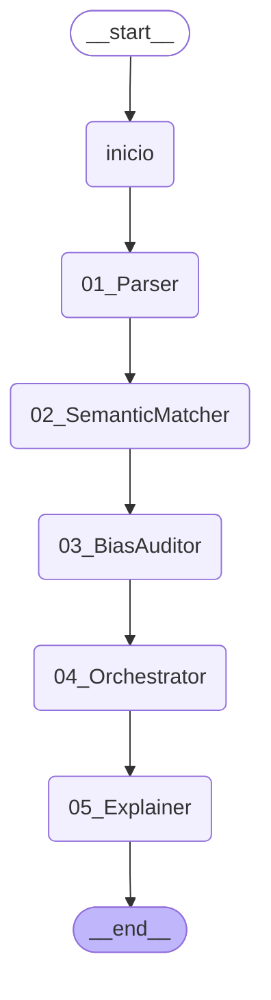

# P4 · Traza del caso BIO-041

> *Ilustrativo, entorno simulado (modo sim); no es evidencia experimental.* · *Semántica LLC propuesta; decisiones 2, 4 y 5 pendientes de la dirección.*

> Generado por código: ningún número de este documento está escrito a mano.

Escenario **BIO** · ventana **BIO-W03** · traza `TRC-A-BIO-041`.

Estados de los roles al procesar el caso (ganados en su propio ciclo de vida): Parser **Trained**; SemanticMatcher **Novice**; BiasAuditor **Born**; Explainer **Trained**. El Orchestrator no tiene teorías (DE-7).

## El DAG de la ventana (LangGraph)



## Documento recibido

El CV trae datos personales, como uno real. El perfil extraído no los retiene (fuga = no) y la Si de ningún rol los contiene (DE-4).

```
<ul><li>Habilidades: Python, Java, Scrum</li><li>Antigüedad: 14 años</li><li>Formación: Licenciatura</li><li>Nacionalidad: AR</li></ul>
```

## Parser

*Agente A-Parser · estado Trained · capa WIO · ciclo 41 del rol.*

| Región | Qué | Valor |
|---|---|---|
| R1 · situación inicial | Si (percepción) | formato = html, estructura = etiquetado, etiquetas = sinonimos |
| R2 · acción | candidatas en la celda (orden de la Fig. 4.21) | 1. T5 · diccionario_sinonimos · Sf completitud = completo, fuga = no · U 0,889 · P 7 · K 7<br>2. T1 · reglas_estrictas · Sf completitud = fallido, fuga = no · U 0,333 · P 1 · K 1 |
| R2 · acción | acción tomada | diccionario_sinonimos — plan: T5, primera del orden de la Fig. 4.21 (U ≥ 0,5) |
| R2 · acción | operador BIO (lo que haría el SAR neutro) | reglas_estrictas |
| R3 · situación final | Sf | completitud = completo, fuga = no |
| R3 · situación final | quién la da | validación SHACL del perfil extraído (PerfilShape) |
| R4 · utilidad | u del ciclo | 1,00 |
| R5 · aprendizaje | registro de la Fig. 4.13 | T5: igual (P + 1, K + 1) |
| R5 · aprendizaje | P, K y U de la teoría después del ciclo | P 8 · K 8 · U 0,900 |
| R6 · estadísticas | ciclo exitoso · acumulados del rol | sí · ciclos 41, exitosos 34, teorías 12, azares 11 |
| R7 · evolución | regla de la Fig. 4.28 ∧ gate de Ω | no se evalúa en este ciclo (se evalúa al cierre de cada intervalo de 20) |

- **Plantilla del documento:** 6 (formato = html, estructura = etiquetado, etiquetas = sinonimos)
- **Perfil extraído:** skills = Python, Scrum, Java, exp = 14, edu = Licenciatura
- **Validación del shape del perfil:** completitud completo, fuga no, faltan nada

## Semantic Matcher

*Agente A-SemanticMatcher · estado Novice · capa TBO · ciclo 41 del rol.*

| Región | Qué | Valor |
|---|---|---|
| R1 · situación inicial | Si (percepción) | skills_match = 1, exp_band = senior, edu = Licenciatura, seniority_ok = sí |
| R2 · acción | candidatas en la celda (orden de la Fig. 4.21) | 1. T11 · ADVANCE · Sf calificado = sí · U 0,857 · P 5 · K 5 |
| R2 · acción | acción tomada | ADVANCE — plan: T11, primera del orden de la Fig. 4.21 (U ≥ 0,5) |
| R2 · acción | operador BIO (lo que haría el SAR neutro) | REJECT |
| R3 · situación final | Sf | calificado = sí |
| R3 · situación final | quién la da | etiqueta del escenario de entrenamiento |
| R4 · utilidad | u del ciclo | 1,00 |
| R5 · aprendizaje | registro de la Fig. 4.13 | T11: igual (P + 1, K + 1) |
| R5 · aprendizaje | P, K y U de la teoría después del ciclo | P 6 · K 6 · U 0,875 |
| R6 · estadísticas | ciclo exitoso · acumulados del rol | sí · ciclos 41, exitosos 30, teorías 20, azares 17 |
| R7 · evolución | regla de la Fig. 4.28 ∧ gate de Ω | no se evalúa en este ciclo (se evalúa al cierre de cada intervalo de 20) |

- **Decisión del Matcher:** ADVANCE

## Bias Auditor (Ω en la cadena)

*Agente A-BiasAuditor · estado Born · capa BIO · ciclo 3 del rol · un ciclo por ventana (BIO-W03, 20 casos).*

| Región | Qué | Valor |
|---|---|---|
| R1 · situación inicial | Si (percepción) | n_por_grupo = 10-49, brecha = media, lcb_supera_tau_b = no |
| R2 · acción | candidatas en la celda (orden de la Fig. 4.21) | 1. T2 · LIBERAR · Sf sesgo_confirmado = no, brecha_errores = media · U 0,667 · P 1 · K 1 |
| R2 · acción | acción tomada | LIBERAR — regla certificada (DE-6): la teoría no decide |
| R2 · acción | operador BIO (lo que haría el SAR neutro) | LIBERAR |
| R3 · situación final | Sf | sesgo_confirmado = no, brecha_errores = baja |
| R3 · situación final | quién la da | revisión de la ventana con la etiqueta del escenario |
| R4 · utilidad | u del ciclo | 1,00 |
| R5 · aprendizaje | registro de la Fig. 4.13 | T3: similar (P = 1, K = K + 1) |
| R5 · aprendizaje | P, K y U de la teoría después del ciclo | P 1 · K 2 · U 0,750 |
| R6 · estadísticas | ciclo exitoso · acumulados del rol | sí · ciclos 3, exitosos 3, teorías 3, azares 0 |
| R7 · evolución | regla de la Fig. 4.28 ∧ gate de Ω | no se evalúa en este ciclo (se evalúa al cierre de cada intervalo de 20) |

- **Medida de la ventana (decisiones del Matcher):** brecha de paridad 0,100, LCB 0,000, n mínimo por grupo 10, τ_b 0,075

## Orchestrator

*Sin base de teorías (DE-7): infraestructura de la capa BIO.*

| Región | Qué | Valor |
|---|---|---|
| decisión final | registrada en la región 7 del trail | ADVANCE |
| escalamiento | ventana derivada por el Bias Auditor | no |

## Explainer

*Agente A-Explainer · estado Trained · capa WIO · ciclo 41 del rol.*

| Región | Qué | Valor |
|---|---|---|
| R1 · situación inicial | Si (percepción) | tipo = avanza, destinatario = regulador, motivos = varios |
| R2 · acción | candidatas en la celda (orden de la Fig. 4.21) | 1. T17 · regulatoria · Sf completa = sí · U 0,800 · P 3 · K 3<br>2. T14 · contrafactica · Sf completa = no · U 0,333 · P 1 · K 1<br>3. T13 · por_factores · Sf completa = no · U 0,333 · P 1 · K 1 |
| R2 · acción | acción tomada | regulatoria — plan: T17, primera del orden de la Fig. 4.21 (U ≥ 0,5) |
| R2 · acción | operador BIO (lo que haría el SAR neutro) | por_factores |
| R3 · situación final | Sf | completa = sí |
| R3 · situación final | quién la da | verificación SPARQL contra el grafo RDF del caso |
| R4 · utilidad | u del ciclo | 1,00 |
| R5 · aprendizaje | registro de la Fig. 4.13 | T17: igual (P + 1, K + 1) |
| R5 · aprendizaje | P, K y U de la teoría después del ciclo | P 4 · K 4 · U 0,833 |
| R6 · estadísticas | ciclo exitoso · acumulados del rol | sí · ciclos 41, exitosos 31, teorías 17, azares 17 |
| R7 · evolución | regla de la Fig. 4.28 ∧ gate de Ω | no se evalúa en este ciclo (se evalúa al cierre de cada intervalo de 20) |

- **Elemento «resultado»:** Resultado: avanza a la siguiente etapa (ADVANCE).
- **Elemento «motivo_principal»:** Motivo principal: skills clave = 1; antigüedad mínima cumplida.
- **Elemento «factores_todos»:** Factores: skills clave = 1, banda de experiencia = senior, educación = Licenciatura, antigüedad mínima cumplida; teoría T11 del Matcher (P = 5, K = 5, U = 0,857).
- **Elemento «dictamen_omega»:** Monitor de Equidad, ventana BIO-W03: brecha de paridad 0,100, LCB = 0,000 frente a τ_b = 0,075; intervención LIBERAR.
- **Elemento «secuencia_trazable»:** Traza TRC-A-BIO-041: Parser → Semantic Matcher → Bias Auditor → Orchestrator (audit trail RDF/PROV-O).
- **Elemento «revision_humana»:** Una persona del equipo puede revisar el caso si lo pedís o si el Monitor de Equidad lo deriva.
- **Verificación contra el grafo del caso:** requisitos: dictamen_omega, factores_todos, motivo_principal, resultado, secuencia_trazable; faltan: nada; inconsistentes: nada

## Qué teorías intervinieron en la decisión (SPARQL sobre `p4_equipo.ttl`)

| Rol | Ciclo | Capa | Estado | Acción | Motivo | Teoría usada como plan: Si → A → Sf (P, K y U al final de la corrida) |
|---|---|---|---|---|---|---|
| bias_auditor | 3 | BIO | Born | LIBERAR | regla_certificada | — |
| explainer | 41 | WIO | Trained | regulatoria | celda | destinatario = regulador, motivos = varios, tipo = avanza → regulatoria → completa = sí (P 38, K 38, U 0,975) |
| matcher | 41 | TBO | Novice | ADVANCE | celda | edu = Licenciatura, exp_band = senior, seniority_ok = sí, skills_match = 1 → ADVANCE → calificado = sí (P 13, K 14, U 0,875) |
| parser | 41 | WIO | Trained | diccionario_sinonimos | celda | estructura = etiquetado, etiquetas = sinonimos, formato = html → diccionario_sinonimos → completitud = completo, fuga = no (P 46, K 48, U 0,940) |

