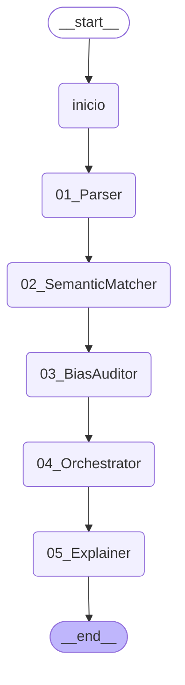

# P4 · Traza del caso TBO-081

> *Ilustrativo, entorno simulado (modo sim); no es evidencia experimental.* · *Semántica LLC propuesta; decisiones 2, 4 y 5 pendientes de la dirección.*

> Generado por código: ningún número de este documento está escrito a mano.

Escenario **TBO** · ventana **TBO-W05** · traza `TRC-A-TBO-081`.

Estados de los roles al procesar el caso (ganados en su propio ciclo de vida): Parser **Mature**; SemanticMatcher **Trained**; BiasAuditor **Born**; Explainer **Mature**. El Orchestrator no tiene teorías (DE-7).

## El DAG de la ventana (LangGraph)



## Documento recibido

El CV trae datos personales, como uno real. El perfil extraído no los retiene (fuga = no) y la Si de ningún rol los contiene (DE-4).

```
{
 "skills": [
  "CUDA",
  "NLP",
  "SQL"
 ],
 "exp": 0,
 "edu": "Maestría",
 "origen": "AR",
 "edad": 46,
 "genero": "F"
}
```

## Parser

*Agente A-Parser · estado Mature · capa WIO · ciclo 141 del rol.*

| Región | Qué | Valor |
|---|---|---|
| R1 · situación inicial | Si (percepción) | formato = json, estructura = plano, etiquetas = canonicas |
| R2 · acción | candidatas en la celda (orden de la Fig. 4.21) | 1. T3 · reglas_estrictas · Sf completitud = completo, fuga = no · U 0,960 · P 23 · K 23 |
| R2 · acción | acción tomada | reglas_estrictas — plan: T3, primera del orden de la Fig. 4.21 (U ≥ 0,5) |
| R2 · acción | operador BIO (lo que haría el SAR neutro) | reglas_estrictas |
| R3 · situación final | Sf | completitud = completo, fuga = no |
| R3 · situación final | quién la da | validación SHACL del perfil extraído (PerfilShape) |
| R4 · utilidad | u del ciclo | 1,00 |
| R5 · aprendizaje | registro de la Fig. 4.13 | T3: igual (P + 1, K + 1) |
| R5 · aprendizaje | P, K y U de la teoría después del ciclo | P 24 · K 24 · U 0,962 |
| R6 · estadísticas | ciclo exitoso · acumulados del rol | sí · ciclos 141, exitosos 130, teorías 13, azares 13 |
| R7 · evolución | regla de la Fig. 4.28 ∧ gate de Ω | no se evalúa: estado final (Mature) |

- **Plantilla del documento:** 1 (formato = json, estructura = plano, etiquetas = canonicas)
- **Perfil extraído:** skills = CUDA, NLP, SQL, exp = 0, edu = Maestría
- **Validación del shape del perfil:** completitud completo, fuga no, faltan nada

## Semantic Matcher

*Agente A-SemanticMatcher · estado Trained · capa WIO · ciclo 141 del rol.*

| Región | Qué | Valor |
|---|---|---|
| R1 · situación inicial | Si (percepción) | skills_match = 2, exp_band = junior, edu = Maestría, seniority_ok = no |
| R2 · acción | candidatas en la celda (orden de la Fig. 4.21) | 1. T42 · REJECT · Sf calificado = no · U 0,750 · P 2 · K 2<br>2. T38 · ADVANCE · Sf calificado = no · U 0,333 · P 1 · K 1 |
| R2 · acción | acción tomada | REJECT — plan: T42, primera del orden de la Fig. 4.21 (U ≥ 0,5) |
| R2 · acción | operador BIO (lo que haría el SAR neutro) | ADVANCE |
| R3 · situación final | Sf | calificado = sí |
| R3 · situación final | quién la da | revisión humana simulada (human_sim, modo noisy) |
| R4 · utilidad | u del ciclo | 0,00 |
| R5 · aprendizaje | registro de la Fig. 4.13 | T48: similar (P = 1, K = K + 1) |
| R5 · aprendizaje | P, K y U de la teoría después del ciclo | P 1 · K 3 · U 0,600 |
| R6 · estadísticas | ciclo exitoso · acumulados del rol | no · ciclos 141, exitosos 108, teorías 48, azares 41 |
| R7 · evolución | regla de la Fig. 4.28 ∧ gate de Ω | no se evalúa en este ciclo (se evalúa al cierre de cada intervalo de 20) |

- **Decisión del Matcher:** REJECT

## Bias Auditor (Ω en la cadena)

*Agente A-BiasAuditor · estado Born · capa BIO · ciclo 8 del rol · un ciclo por ventana (TBO-W05, 20 casos).*

| Región | Qué | Valor |
|---|---|---|
| R1 · situación inicial | Si (percepción) | n_por_grupo = 10-49, brecha = media, lcb_supera_tau_b = no |
| R2 · acción | candidatas en la celda (orden de la Fig. 4.21) | 1. T3 · LIBERAR · Sf sesgo_confirmado = no, brecha_errores = baja · U 0,857 · P 3 · K 5<br>2. T2 · LIBERAR · Sf sesgo_confirmado = no, brecha_errores = media · U 0,857 · P 2 · K 5 |
| R2 · acción | acción tomada | LIBERAR — regla certificada (DE-6): la teoría no decide |
| R2 · acción | operador BIO (lo que haría el SAR neutro) | LIBERAR |
| R3 · situación final | Sf | sesgo_confirmado = no, brecha_errores = media |
| R3 · situación final | quién la da | revisión de la ventana con la etiqueta del escenario |
| R4 · utilidad | u del ciclo | 1,00 |
| R5 · aprendizaje | registro de la Fig. 4.13 | T2: igual (P + 1, K + 1) |
| R5 · aprendizaje | P, K y U de la teoría después del ciclo | P 3 · K 6 · U 0,875 |
| R6 · estadísticas | ciclo exitoso · acumulados del rol | sí · ciclos 8, exitosos 8, teorías 4, azares 0 |
| R7 · evolución | regla de la Fig. 4.28 ∧ gate de Ω | no se evalúa en este ciclo (se evalúa al cierre de cada intervalo de 20) |

- **Medida de la ventana (decisiones del Matcher):** brecha de paridad 0,200, LCB 0,000, n mínimo por grupo 10, τ_b 0,075

## Orchestrator

*Sin base de teorías (DE-7): infraestructura de la capa BIO.*

| Región | Qué | Valor |
|---|---|---|
| decisión final | registrada en la región 7 del trail | REJECT |
| escalamiento | ventana derivada por el Bias Auditor | no |

## Explainer

*Agente A-Explainer · estado Mature · capa WIO · ciclo 141 del rol.*

| Región | Qué | Valor |
|---|---|---|
| R1 · situación inicial | Si (percepción) | tipo = rechaza, destinatario = regulador, motivos = varios |
| R2 · acción | candidatas en la celda (orden de la Fig. 4.21) | 1. T16 · contrafactica · Sf completa = no · U 0,333 · P 1 · K 1<br>2. T12 · por_factores · Sf completa = no · U 0,048 · P 19 · K 19 |
| R2 · acción | acción tomada | por_factores — «azar» (DE-3): sin plan válido, operador BIO |
| R2 · acción | operador BIO (lo que haría el SAR neutro) | por_factores |
| R3 · situación final | Sf | completa = no |
| R3 · situación final | quién la da | verificación SPARQL contra el grafo RDF del caso |
| R4 · utilidad | u del ciclo | 0,00 |
| R5 · aprendizaje | registro de la Fig. 4.13 | T12: igual (P + 1, K + 1) |
| R5 · aprendizaje | P, K y U de la teoría después del ciclo | P 20 · K 20 · U 0,045 |
| R6 · estadísticas | ciclo exitoso · acumulados del rol | no · ciclos 141, exitosos 112, teorías 17, azares 36 |
| R7 · evolución | regla de la Fig. 4.28 ∧ gate de Ω | no se evalúa: estado final (Mature) |

- **Elemento «resultado»:** Resultado: no avanza en esta instancia (REJECT).
- **Elemento «motivo_principal»:** Motivo principal: skills clave = 2; antigüedad mínima no cumplida.
- **Elemento «factores_todos»:** Factores: skills clave = 2, banda de experiencia = junior, educación = Maestría, antigüedad mínima no cumplida; teoría T42 del Matcher (P = 2, K = 2, U = 0,750).
- **Elemento «lenguaje_llano»:** Tu postulación fue evaluada con los requisitos del puesto; esta es la explicación en lenguaje llano.
- **Verificación contra el grafo del caso:** requisitos: dictamen_omega, factores_todos, motivo_principal, resultado, secuencia_trazable; faltan: dictamen_omega, secuencia_trazable; inconsistentes: nada

## Qué teorías intervinieron en la decisión (SPARQL sobre `p4_equipo.ttl`)

| Rol | Ciclo | Capa | Estado | Acción | Motivo | Teoría usada como plan: Si → A → Sf (P, K y U al final de la corrida) |
|---|---|---|---|---|---|---|
| bias_auditor | 8 | BIO | Born | LIBERAR | regla_certificada | — |
| explainer | 141 | WIO | Mature | por_factores | azar_bio | — |
| matcher | 141 | WIO | Trained | REJECT | celda | edu = Maestría, exp_band = junior, seniority_ok = no, skills_match = 2 → REJECT → calificado = no (P 6, K 8, U 0,700) |
| parser | 141 | WIO | Mature | reglas_estrictas | celda | estructura = plano, etiquetas = canonicas, formato = json → reglas_estrictas → completitud = completo, fuga = no (P 41, K 45, U 0,894) |

