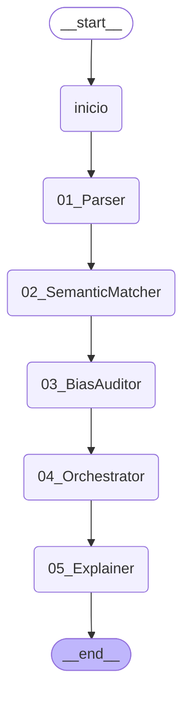

# P4 · Traza del caso WIO-081

> *Ilustrativo, entorno simulado (modo sim); no es evidencia experimental.* · *Semántica LLC propuesta; decisiones 2, 4 y 5 pendientes de la dirección.*

> Generado por código: ningún número de este documento está escrito a mano.

Escenario **WIO** · ventana **WIO-W05** · traza `TRC-A-WIO-081`.

Estados de los roles al procesar el caso (ganados en su propio ciclo de vida): Parser **Mature**; SemanticMatcher **Trained**; BiasAuditor **Born**; Explainer **Mature**. El Orchestrator no tiene teorías (DE-7).

## El DAG de la ventana (LangGraph)



## Documento recibido

El CV trae datos personales, como uno real. El perfil extraído no los retiene (fuga = no) y la Si de ningún rol los contiene (DE-4).

```
{
 "skills": [
  "ML",
  "Python",
  "CUDA"
 ],
 "exp": 0,
 "edu": "Maestría",
 "origen": "AR",
 "edad": 23,
 "genero": "F"
}
```

## Parser

*Agente A-Parser · estado Mature · capa WIO · ciclo 241 del rol.*

| Región | Qué | Valor |
|---|---|---|
| R1 · situación inicial | Si (percepción) | formato = json, estructura = plano, etiquetas = canonicas |
| R2 · acción | candidatas en la celda (orden de la Fig. 4.21) | 1. T3 · reglas_estrictas · Sf completitud = completo, fuga = no · U 0,929 · P 38 · K 40<br>2. T14 · reglas_estrictas · Sf completitud = parcial, fuga = no · U 0,929 · P 2 · K 40 |
| R2 · acción | acción tomada | reglas_estrictas — plan: T3, primera del orden de la Fig. 4.21 (U ≥ 0,5) |
| R2 · acción | operador BIO (lo que haría el SAR neutro) | reglas_estrictas |
| R3 · situación final | Sf | completitud = completo, fuga = no |
| R3 · situación final | quién la da | validación SHACL del perfil extraído (PerfilShape) |
| R4 · utilidad | u del ciclo | 1,00 |
| R5 · aprendizaje | registro de la Fig. 4.13 | T3: igual (P + 1, K + 1) |
| R5 · aprendizaje | P, K y U de la teoría después del ciclo | P 39 · K 41 · U 0,930 |
| R6 · estadísticas | ciclo exitoso · acumulados del rol | sí · ciclos 241, exitosos 215, teorías 16, azares 13 |
| R7 · evolución | regla de la Fig. 4.28 ∧ gate de Ω | no se evalúa: estado final (Mature) |

- **Plantilla del documento:** 1 (formato = json, estructura = plano, etiquetas = canonicas)
- **Perfil extraído:** skills = ML, Python, CUDA, exp = 0, edu = Maestría
- **Validación del shape del perfil:** completitud completo, fuga no, faltan nada

## Semantic Matcher

*Agente A-SemanticMatcher · estado Trained · capa WIO · ciclo 241 del rol.*

| Región | Qué | Valor |
|---|---|---|
| R1 · situación inicial | Si (percepción) | skills_match = 3, exp_band = junior, edu = Maestría, seniority_ok = no |
| R2 · acción | candidatas en la celda (orden de la Fig. 4.21) | 1. T32 · REJECT · Sf calificado = no · U 0,800 · P 7 · K 8<br>2. T50 · REJECT · Sf calificado = sí · U 0,800 · P 1 · K 8<br>3. T31 · ADVANCE · Sf calificado = no · U 0,400 · P 2 · K 3<br>4. T29 · ADVANCE · Sf calificado = sí · U 0,400 · P 1 · K 3 |
| R2 · acción | acción tomada | REJECT — plan: T32, primera del orden de la Fig. 4.21 (U ≥ 0,5) |
| R2 · acción | operador BIO (lo que haría el SAR neutro) | ADVANCE |
| R3 · situación final | Sf | calificado = no |
| R3 · situación final | quién la da | revisión humana simulada (human_sim, modo noisy) |
| R4 · utilidad | u del ciclo | 1,00 |
| R5 · aprendizaje | registro de la Fig. 4.13 | T32: igual (P + 1, K + 1) |
| R5 · aprendizaje | P, K y U de la teoría después del ciclo | P 8 · K 9 · U 0,818 |
| R6 · estadísticas | ciclo exitoso · acumulados del rol | sí · ciclos 241, exitosos 183, teorías 66, azares 60 |
| R7 · evolución | regla de la Fig. 4.28 ∧ gate de Ω | no se evalúa: capa agotada sin promoción |

- **Decisión del Matcher:** REJECT

## Bias Auditor (Ω en la cadena)

*Agente A-BiasAuditor · estado Born · capa BIO · ciclo 13 del rol · un ciclo por ventana (WIO-W05, 20 casos).*

| Región | Qué | Valor |
|---|---|---|
| R1 · situación inicial | Si (percepción) | n_por_grupo = 10-49, brecha = media, lcb_supera_tau_b = no |
| R2 · acción | candidatas en la celda (orden de la Fig. 4.21) | 1. T3 · LIBERAR · Sf sesgo_confirmado = no, brecha_errores = baja · U 0,889 · P 4 · K 7<br>2. T2 · LIBERAR · Sf sesgo_confirmado = no, brecha_errores = media · U 0,889 · P 3 · K 7 |
| R2 · acción | acción tomada | LIBERAR — regla certificada (DE-6): la teoría no decide |
| R2 · acción | operador BIO (lo que haría el SAR neutro) | LIBERAR |
| R3 · situación final | Sf | sesgo_confirmado = no, brecha_errores = alta |
| R3 · situación final | quién la da | revisión de la ventana con la etiqueta del escenario |
| R4 · utilidad | u del ciclo | 1,00 |
| R5 · aprendizaje | registro de la Fig. 4.13 | T7: similar (P = 1, K = K + 1) |
| R5 · aprendizaje | P, K y U de la teoría después del ciclo | P 1 · K 8 · U 0,900 |
| R6 · estadísticas | ciclo exitoso · acumulados del rol | sí · ciclos 13, exitosos 13, teorías 7, azares 0 |
| R7 · evolución | regla de la Fig. 4.28 ∧ gate de Ω | no se evalúa en este ciclo (se evalúa al cierre de cada intervalo de 20) |

- **Medida de la ventana (decisiones del Matcher):** brecha de paridad 0,200, LCB 0,000, n mínimo por grupo 10, τ_b 0,075

## Orchestrator

*Sin base de teorías (DE-7): infraestructura de la capa BIO.*

| Región | Qué | Valor |
|---|---|---|
| decisión final | registrada en la región 7 del trail | REJECT |
| escalamiento | ventana derivada por el Bias Auditor | no |

## Explainer

*Agente A-Explainer · estado Mature · capa WIO · ciclo 241 del rol.*

| Región | Qué | Valor |
|---|---|---|
| R1 · situación inicial | Si (percepción) | tipo = rechaza, destinatario = usuario, motivos = varios |
| R2 · acción | candidatas en la celda (orden de la Fig. 4.21) | 1. T11 · contrafactica · Sf completa = sí · U 0,984 · P 61 · K 61<br>2. T8 · por_factores · Sf completa = no · U 0,333 · P 1 · K 1 |
| R2 · acción | acción tomada | contrafactica — plan: T11, primera del orden de la Fig. 4.21 (U ≥ 0,5) |
| R2 · acción | operador BIO (lo que haría el SAR neutro) | por_factores |
| R3 · situación final | Sf | completa = sí |
| R3 · situación final | quién la da | verificación SPARQL contra el grafo RDF del caso |
| R4 · utilidad | u del ciclo | 1,00 |
| R5 · aprendizaje | registro de la Fig. 4.13 | T11: igual (P + 1, K + 1) |
| R5 · aprendizaje | P, K y U de la teoría después del ciclo | P 62 · K 62 · U 0,984 |
| R6 · estadísticas | ciclo exitoso · acumulados del rol | sí · ciclos 241, exitosos 187, teorías 17, azares 61 |
| R7 · evolución | regla de la Fig. 4.28 ∧ gate de Ω | no se evalúa: estado final (Mature) |

- **Elemento «resultado»:** Resultado: no avanza en esta instancia (REJECT).
- **Elemento «motivo_principal»:** Motivo principal: skills clave = 3; antigüedad mínima no cumplida.
- **Elemento «lenguaje_llano»:** Tu postulación fue evaluada con los requisitos del puesto; esta es la explicación en lenguaje llano.
- **Elemento «accion_sugerida»:** Qué cambiaría el resultado: acreditar al menos 3 años de experiencia y al menos 1 skill clave del puesto.
- **Elemento «revision_humana»:** Una persona del equipo puede revisar el caso si lo pedís o si el Monitor de Equidad lo deriva.
- **Verificación contra el grafo del caso:** requisitos: accion_sugerida, lenguaje_llano, motivo_principal, resultado; faltan: nada; inconsistentes: nada

## Qué teorías intervinieron en la decisión (SPARQL sobre `p4_equipo.ttl`)

| Rol | Ciclo | Capa | Estado | Acción | Motivo | Teoría usada como plan: Si → A → Sf (P, K y U al final de la corrida) |
|---|---|---|---|---|---|---|
| bias_auditor | 13 | BIO | Born | LIBERAR | regla_certificada | — |
| explainer | 241 | WIO | Mature | contrafactica | celda | destinatario = usuario, motivos = varios, tipo = rechaza → contrafactica → completa = sí (P 70, K 70, U 0,986) |
| matcher | 241 | WIO | Trained | REJECT | celda | edu = Maestría, exp_band = junior, seniority_ok = no, skills_match = 3 → REJECT → calificado = no (P 9, K 10, U 0,833) |
| parser | 241 | WIO | Mature | reglas_estrictas | celda | estructura = plano, etiquetas = canonicas, formato = json → reglas_estrictas → completitud = completo, fuga = no (P 41, K 45, U 0,894) |

